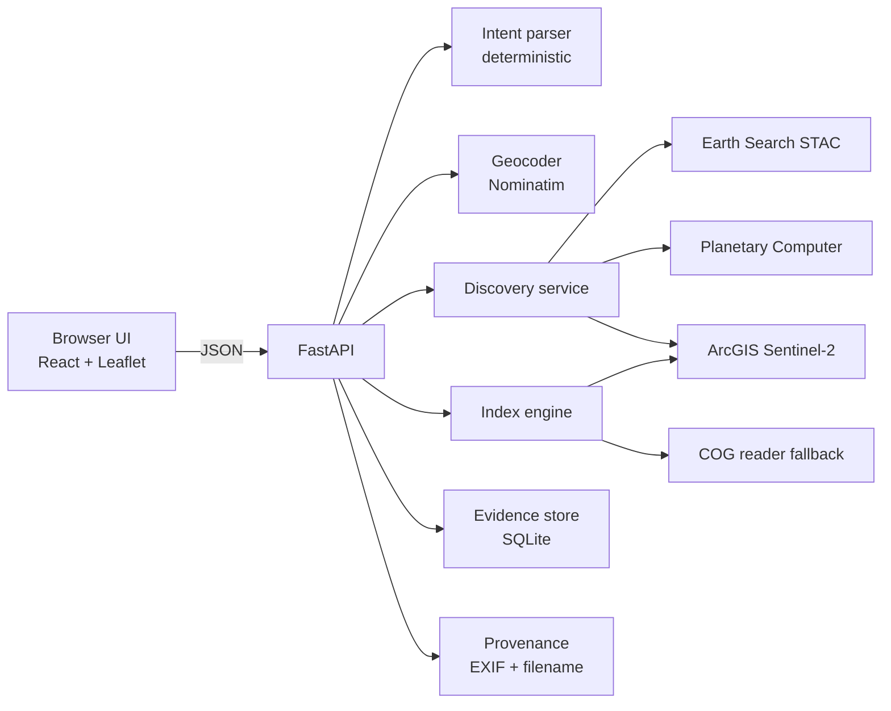

# SEMINAR 2 — SAGE
## Spatial Analysis & Geospatial Exploration · Project Work-2 Planning Document

| Field | Value |
|---|---|
| Project | **SAGE — Spatial Analysis & Geospatial Exploration** |
| Programme | BE (CSE) VII Semester → Project Work-2, 2026–2027 |
| Students | 1. Saif Ali Baig  2. Abdul Razzaq |
| Guide | Dr. Syed Shabbeer Ahmad |
| Institution | Muffakham Jah College Engineering and Technology, Dept. of CSE |
| Predecessor | Seminar 1 document (`presentation.md`) + prototype in `sage/` |
| This document | Planning, objectives, methodology, datasets, architecture, metrics, novelty, integrity |
| Built artifact | `sage2/` — prototype described in §6 and §10 |

> **What changed from Seminar 1.** Seminar 1 proposed a broad platform (discovery + upload metadata + NDVI + classification + change detection + GeoJSON export). That scope was too wide to defend and its central claim ("nobody has built this") was **falsified during full-text reading** — [44] *Risk-Aware LLM Agents for Geospatial Data Retrieval* does natural-language → catalogue API calls, commercially.
>
> **Seminar 2 narrows the claim to something defensible and testable:** the free, no-login, browser-first, **AOI-driven** path, where **every number is produced by an authoritative deterministic service and every result is reproducible from an evidence ID.** The AI is confined to *parsing language*, never to producing measurements.

---

## 0. Reference-material audit (what was actually available)

| Requested source | Status | What it contributes |
|---|---|---|
| `github.com/simsieg/awesome-maps` | ✅ read | A **categorised directory of ~120 map sources** ("there is more than Google"). Directly shapes design decision **D3**: SAGE's source list must be a *curated, categorised catalogue with capability metadata*, not three hard-coded providers. Its own satellite section (Sentinel Hub, EarthExplorer, RAMMB SLIDER) is exactly the fragmented-portal problem we document. |
| `sentinel.arcgis.com/.../Sentinel2/ImageServer` | ✅ **live-tested** | A genuinely new capability: **unauthenticated server-side NDVI/NDWI/NBR/NDBI + real statistics**. Verified below. This becomes the backbone of the deterministic index engine. |
| **`Aleph` folder** | ✅ **AVAILABLE — read and applied** | `Aleph/` contains `alephgeo` 0.2.0 (MIT, Belluxx): a Python CLI that captures satellite, Street View, OSM and terrain data for a drawn area. Core modules read: `aleph.py`, `src/common.py`, `src/places.py`, `src/geo.py`, `src/capture.py`, `src/cli.py`, `AGENTS.md`, `pyproject.toml`. Adopted patterns are listed in §0.2 and D9–D12. |
| Research papers [1]–[50] | ✅ `presentation.md` | Design + evaluation precedent (esp. [44] closest prior art, [45] exact-ground-truth evaluation, [46] evaluation standards, [47] code-first > black-box, [48] NLIDB gaps) |
| `sage/` prototype | ✅ | Working discovery layer to be refined, not discarded |

### 0.1 Live verification of the data sources (run 2026-11-12)

Every row below was executed, not assumed.

| Probe | Command target | Result |
|---|---|---|
| Service metadata | `ImageServer?f=json` | `name=Sentinel2`, `pixelType=U16`, `bandCount=13`, `capabilities=Image,Metadata,Catalog,Mensuration`, `supportsAdvancedQueries=true`, `maxImageWidth/Height=4000` |
| **NDVI statistics over an AOI, no auth** | `computeStatisticsHistograms` + `{"rasterFunction":"NDVI Raw"}` | **`min=-0.2668, max=0.5164, mean=0.1297, sd=0.0923, count=7,792,220`** |
| NDVI image for an AOI | `exportImage` + `{"rasterFunction":"NDVI Colormap"}` | `HTTP 200`, `image/png`, 256×256, 30 826 bytes |
| Point sample, 13 bands | `identify` | `value="2915, 2635, 2432, 2317, 2281, 3141, 3609, 3449, 3758, 1451, 1011, 2732, 1952"` |
| Catalogue query | `query?where=cloudcover<20` | `count = 4 951 994` |
| **cloudcover units** | counts at `<1`, `<20`, `<100` | `4 648 959` / `4 951 994` / `4 951 994` — a 0–1 fraction would make all three equal, so **percent 0–100 confirmed** |
| **Earth Search CQL2** | `filter` on `eo:cloud_cover < 20` | **silently ignored** — returned a 96.7 % cloud scene; the `query` extension works (4.1 %, 4.2 %) |
| **Temporal window** | `query` limited to 2024-06 | **`count = 0`** — the service holds only a **rolling ~14-month window** (metadata states "imagery collected within the past 14 months", updated daily) |
| Earth Search STAC | `POST /v1/search`, `datetime=2024-06-01/2024-06-30` | **`HTTP 400` — "datetime value is invalid, does not match RFC3339 format"** |
| Earth Search STAC (fixed) | `datetime=2024-06-01T00:00:00Z/…` | see §4.2 |
| Planetary Computer STAC | `POST /api/stac/v1/search` with `query` ext | **`HTTP 200`** |
| Earth Search collections | `/v1/collections` | `sentinel-2-l2a, sentinel-2-c1-l2a, sentinel-2-l1c, landsat-c2-l2, sentinel-1-grd, naip, cop-dem-glo-30/90` |

**Three findings that change the design:**
1. The ArcGIS service gives **real deterministic index statistics with no authentication and no key** — so "no-login" survives contact with the requirement for numbers. This is the single most important discovery for Seminar 2.
2. It covers **only the last ~14 months**. It therefore cannot serve historical queries, and must be presented as a *current-condition* source, not an archive. Any claim of "historical analysis" must route to STAC.
3. Earth Search's `datetime` is **strict RFC3339** (needs `T…Z`). Its **CQL2 `filter` extension is accepted but silently ignored** — a `<20 %` filter still returned a 96.7 % cloud scene — while the `query` extension does work. The adapter therefore uses `query` **and re-filters client-side**. A prototype that "works on my machine" with a lenient date string, or that trusts a filter the server ignores, returns wrong results while looking perfectly healthy.

### 0.1.1 Probes added for the second iteration (run 2026-11-13)

These were run while adding class areas, same-month comparison and thermal change. Two of them
overturned an assumption, which is why they are recorded here rather than in a commit message.

| Probe | Command target | Result |
|---|---|---|
| Histogram shape | `computeStatisticsHistograms` + `NDVI Raw` over the 708 km² AOI | **256 bins** spanning the *observed* min/max (`−0.2668…0.5164`), not a fixed −1…1 range. So a class threshold can be applied to bin centres, and the bin width is the honest resolution limit of the estimate. |
| Median mosaic rule | `mosaicRule: {"mosaicMethod":"median"}` vs `"banana"` vs `esriMosaicNadir` | **`median` and `banana` return the identical mean (0.1196); `esriMosaicNadir` returns a different one.** The rule is parsed, `median` is simply not a valid method, and the service answers HTTP 200 without complaint. A pixel-wise median composite is therefore **not available**; the same-month comparison reports the median across *acquisitions* instead. |
| Time filter on statistics | statistics call with `time` limited to Nov 2026 | **Works** — mean changes from 0.1196 (no window) to 0.1516 (windowed), unlike `exportImage`, which returns a blank 4 KB PNG for a windowed request. Per-acquisition pinning by `objectid` remains the safest route and is what the code uses. |
| Landsat thermal availability | `Landsat8_Views/ImageServer?f=json` | `bandCount=11`, thermal at indices **9/10**, pixel type `S16`, archive **2020-01-01 → present**. Catalogue fields are capitalised (`OBJECTID`, `AcquisitionDate`, `CloudCover`, `Name`); lowercase `outFields` silently yields nulls. |
| Thermal calibration sanity check | DN → radiance (`×0.0003342`) → inverse Planck, Landsat 8 constants | Water **26.5 °C**, urban **29.7 °C** over Hussain Sagar — a +3.2 °C heat-island ordering that matches expectation, so the calibration path is sound. |
| Thermal cloud contamination | five Novembers of the same AOI | Hand-checked: a scene listed at **0.9 % cloud averaged −12 °C** (cloud top) while a clear scene read **+26 °C**; within Nov 2025 alone the three usable scenes read 25.9 / 16.1 / 11.0 °C. Catalogue cloud cover is a whole-scene figure and cannot be trusted over a small AOI, and this endpoint exposes no QA mask — so the service rejects scenes outside a plausible physical range and reports the spread. |

**What this changes in the argument.** Tier 1 (class areas) is a threshold on data we already had,
so it adds no request and no new source; Tier 2 is honest only if it is described as a median
*across acquisitions*, because the pixel-wise version is unavailable; Tier 3 must be described as
**at-sensor brightness temperature**, because LST would require emissivity and an atmospheric
correction this service does not provide. Each of those is a narrower claim than the obvious one,
and each is the claim the measurement can actually support.

### 0.2 What the `Aleph` reference contributed

`Aleph/aleph.py` + `src/` is `alephgeo` 0.2.0 (MIT, Belluxx) — a dependency-light Python CLI (Pillow + numpy only, no API key) that resolves a place, plans a capture, then downloads satellite / Street View / OSM / terrain products into a resumable run folder. It is a *capture* tool, not an analysis tool, so it contributes engineering discipline rather than spectral method. Four patterns were adopted verbatim in shape:

| Aleph pattern | Where it lives in Aleph | What SAGE now does |
|---|---|---|
| **`RequestError(code, message, **details)`** with a stable code vocabulary | `src/common.py`, mapped to exit codes in `aleph.py` | `app/errors.py` + one FastAPI handler: every failure returns `{"status":"error","error":{"code","message",…}}` with codes `invalid_arguments`, `place_not_found`, `ambiguous_place`, `provider_unavailable`, `evidence_not_found` |
| **Ambiguity is refused, never guessed** — `choose()` raises `ambiguous_place` carrying the candidates, resolved by `--match TYPE/ID` or `--best-match` | `src/places.py::choose` | `/api/query` returns HTTP 409 + candidates in Aleph's `TYPE/ID` form (`N/123`, `W/123`, `R/123`, from OSM `osm_type` + `osm_id`); the UI renders a picker and re-issues with `place_id` |
| **`Client` + `CachedClient`** — per-host pacing, bounded retries with exponential backoff, sha256-keyed response cache reporting `hits`/`misses` | `src/common.py` | `app/services/net.py::Fetch`: 250 ms same-host pacing, 3 retries, sha256-keyed cache, `cache {hits, misses}` in every search/index response |
| **Plan → estimate → confirm → manifest** — `describe()`/`estimate()`/`--plan` before spending requests; `manifest.json` records settings, sources and coverage notes per run | `aleph.py::describe`, `src/capture.py` | `/api/plan` returns providers, request count and an estimated duration *before* fan-out; evidence records became self-describing manifests (`format`, `version`, `status`, `environment`, `cache`) |

Two supporting habits were also taken: **validate before the network** (`src/geo.py::bounds` rejects non-finite, inverted and date-line-crossing boxes) now guards every bbox through `geo.validate_bbox`; and **atomic writes with `allow_nan=False`** (`src/common.py::atomic_path`, `write_json`) stop a partial or NaN-bearing record from reaching the evidence log.

**Deliberate divergences (stated so they are not mistaken for oversight):**

1. **Cache lifetime.** Aleph caches quick-query responses to disk for 7 days. SAGE keeps its cache in-process with a 300 s TTL, because index statistics describe a mosaic the provider updates daily — a week-old cached mean would be a *wrong* number, not a stale one. Names are cached for 24 h, since place names rarely move.
2. **No download pipeline.** Aleph's resume/export machinery exists because it moves gigabytes of tiles. SAGE requests small statistics payloads, so a full resume system would be unused weight; the *manifest* idea survives, the folder/resume machinery does not.
3. **Analysis is still ours.** Aleph supplies no spectral index, no AOI statistics, no evidence id and no ranking. Those remain the contribution and are cited as such.

---

## 1. Plan

### 1.1 Problem restated (narrowed)

> A non-expert has a **place or a drawn area**, and a **question about current or recent ground conditions**. Free imagery exists. What does not exist is a free, login-free, browser-only path that turns that area into (a) the correct available scenes and (b) **a number they can defend**, without installing GIS software or reading code.

### 1.2 What Seminar 2 must prove

| # | Proposition to demonstrate | How it will be shown |
|---|---|---|
| **P1** | A user can go from "drawn area / place name" to correctly-sourced scenes in one screen, with no login | Live prototype, measured time-to-first-result |
| **P2** | The numbers are **deterministic and independently verifiable** | Cross-check NDVI against an independently computed value from a downloaded COG; report MAE/R² |
| **P3** | The natural-language layer is **inspectable and correctable**, not a black box | Parsed intent shown as editable chips; slot-level F1 vs two baselines |
| **P4** | Any past result can be **re-derived exactly** | Evidence-ID replay test — re-run from the ID and compare outputs |
| **P5** | The system is honest about its own limits | Explicit source-capability matrix and a "why this may be wrong" panel |

### 1.3 Phases, deliverables, exit criteria

| Phase | Weeks | Work | Deliverable | Exit criterion |
|---|---|---|---|---|
| **P0 — Ground truth first** | 1–2 | Freeze the source matrix; build the **gold sets** (places, utterances, expected scenes) *before* building features | `datasets/gold_places.json`, `datasets/gold_utterances.json`, `datasets/gold_scenes.json` | Gold sets reviewed and frozen; no metric changed afterwards without a logged amendment |
| **P1 — Deterministic core** | 3–5 | Source adapters, canonical schema, dedup/rank, AOI normalisation, index engine | `sage2/backend` search + index endpoints | Live NDVI stats over 5 AOIs reproduce within ±0.01 of the service's own value |
| **P2 — Language layer** | 6–8 | Rule-based intent parser, disambiguation, editable-intent UI | `/query` + intent chips | Slot F1 ≥ 0.90 on the frozen gold set |
| **P3 — Provenance & evidence** | 9–10 | Uploaded-image metadata recovery; evidence-ID hashing and replay | `/metadata`, `/evidence/{id}` | Replay reproduces identical index values |
| **P4 — Frontend integration** | 11–13 | Single-screen workflow, timeline, index panel, export | `sage2/frontend` | Full demo path completes without console errors |
| **P5 — Evaluation** | 14–16 | Index-correctness study, benchmark run, user study (n≈10–12) | `evaluation/results.md` + scripts | Metrics reported with CIs; failures reported too |
| **P6 — Paper & defence** | 17–18 | Write-up per the §7 metrics | Report + slides | Every number in the report traceable to a script |

**Drop order under time pressure:** P3 → P4 polish → P2 LLM baseline. **Never drop P0 or P5** — without frozen gold sets and an evaluation, the project is a demo, not research.

---

## 2. Finalised objectives

Each objective is measurable, dated, and tied to a proposition in §1.2.

| ID | Objective | Metric / target | Prop. |
|---|---|---|---|
| **O1** | Survey free EO sources and produce a **capability matrix** (coverage, resolution, auth, temporal window, index support, licence) | Matrix covers ≥8 sources; every cell verified by a live probe | P5 |
| **O2** | Implement a **multi-provider discovery layer** returning one canonical scene schema | ≥3 providers; dedup precision ≥0.95 on a 30-scene hand-checked set | P1 |
| **O3** | Implement **AOI-first search** from a drawn polygon, place name, or bbox | AOI round-trip correct (area within 2 % of geodesic truth) | P1 |
| **O4** | Implement a **deterministic index engine** for NDVI, NDWI, NBR, NDBI over an AOI | Mean index MAE ≤ 0.02 vs independent COG computation on 5 AOIs | P2 |
| **O5** | Implement a **rule-based NL intent parser** with an editable, visible intent | Slot F1 ≥ 0.90; end-to-end exact ≥ 0.80 on frozen set | P3 |
| **O6** | Implement **uploaded-image provenance recovery** (mission, date, tile, footprint) with confidence tiers | Correct mission+date on ≥80 % of 25 test images; **abstain** rather than guess when uncertain | P4 |
| **O7** | Implement **evidence IDs** and replay | 100 % of stored evidence IDs replay to identical index statistics | P4 |
| **O8** | **Evaluate** discovery, indices, parsing and usability, reporting failures | All metrics with n, mean, 95 % CI; failures tabulated | P5 |
| **O9** | Keep the client responsive with **server-side heavy compute** and WebGL-ready rendering | p95 search < 4 s; index stats < 5 s; no main-thread block > 200 ms | P1 |
| **O10** | **Validate** on ≥3 scenarios (agriculture, urban growth, water body) with reproducible cases | 3 documented case studies, each replayable by evidence ID | P5 |

### 2.1 Explicit non-goals (state these to the panel before they ask)

- Not training a foundation model; we **consume** existing ones.
- Not SAR/InSAR processing (out of scope; [10] cited as future work).
- Not commercial or high-resolution imagery procurement.
- Not a general GIS editor (that is GeoLibre/QGIS territory — we cite them as inspiration, not competitors).
- Not an LLM-driven agent that authors numbers. Language in, **language only out**.

### 2.2 Target audience (finalised)

SAGE is for people who have a **question about a place** and no GIS workflow — not for people who already own one. Three tiers, ranked by how far the prototype currently serves them.

| Tier | Who | What they arrive with | What SAGE gives them | Known gap |
|---|---|---|---|---|
| **Primary — students and early-career researchers** (environmental science, civil and agricultural engineering, geography, urban planning) | Coursework, minor projects, seminar papers; usually no QGIS licence, no Earth Engine account, no cloud credits | A place name or a hand-drawn box, a date or season, and a question like "is there vegetation / water / burn / built-up change here?" | Scenes from three catalogues in one view, a defensible NDVI/NDWI/NBR/NDBI number with pixel count and a QC status, an index image, and an evidence id that re-derives the result; one-click download of the imagery for a figure | Needs a citation line and a figure caption in the exported files |
| **Secondary — journalists, NGOs, municipal and panchayat staff** | Verifying a claim ("the lake shrank", "the landfill grew") for a one-page brief | A named location and a time window; zero tolerance for a confidently wrong number | A number they can attribute plus a manifest showing exactly which acquisition, date and rendering rule produced it; an explicit refusal when the AOI or window is outside coverage | Needs plain-language interpretation, not just statistics |
| **Tertiary — GIS practitioners** | Fast reconnaissance before committing to a QGIS/ArcGIS Pro workflow | Existing tools and an expectation of full control | A quick capability check and a shareable evidence record | Will outgrow it immediately, which is expected |

**Explicitly not the audience** (state this before the panel asks):

- Operational users who need guaranteed uptime, an SLA, or sub-metre imagery.
- Emergency response — a daily-updated 10 m mosaic and a 14-month window are the wrong instrument, and delay is unacceptable.
- Anyone needing SAR, hyperspectral, or commercial tasking.
- GIS teaching itself: SAGE is not a substitute for learning projections and band arithmetic, and the interface says so rather than pretending.

**Why this audience and not "everyone".** Each tier's question is answerable with *unauthenticated, openly licensed 10 m Sentinel-2* and *a number that survives a re-run* — exactly the envelope the architecture can defend. Climate-finance analysts, defence users and precision-agriculture operators need resolutions or credentials SAGE does not have; claiming them would be the same overclaim §8.2 forbids.

**Design consequences that follow from this audience** (so the choice is not decorative):

1. **No login anywhere in the demo path** — every tier has to start from zero setup (P1).
2. **The interpretation is shown as editable chips**, because a non-expert cannot debug a black box they cannot see into (P3).
3. **Statistics are refused, not guessed**, when the AOI is wider than 38 km per side or fewer than 30 % of expected pixels are valid (§3.5, D15).
4. **Evidence ids exist for defence of a number** — the primary user to an examiner, the secondary user to an editor.
5. **Download ships a manifest, not just a file**, so the image a student puts in a report can be traced back to its acquisition and rendering rule.

---

## 3. System methodology and algorithms

### 3.1 Pipeline

```
text/geometry ──► [1] Intent parse ──► [2] AOI resolve ──► [3] Fan-out search
                                          │                      │
                                          ▼                      ▼
                                   [4] Canonicalise      [5] Dedup + rank
                                                                 │
                                    ┌────────────────────────────┴──────────┐
                                    ▼                                       ▼
                          [6] Scene list (UI)                  [7] Index engine (deterministic)
                                                                           │
                                                              [8] Evidence ID + export
```

### 3.2 A1 — Intent parsing (deterministic, inspectable)

Rule-based slot filling with an explicit precedence order; **no LLM in the numeric path**.

- **Slots:** `place`, `date_from`, `date_to`, `max_cloud`, `mission`, `index`, `aoi_geometry`.
- **Precedence rules that matter** (learned from the Seminar 1 error analysis):
  1. `last <season>` beats bare `<season>`;
  2. `<month> to <month> this year` beats bare `this year`;
  3. `<season> <year>` beats bare `<year>`;
  4. month/season tokens are **stripped from place candidates** before geocoding (Seminar 1 bug: "Tokyo June" → geocoded a hairdresser in Tokyo);
  5. year separators accept `to | through | and | – | -`.
- **Cloud phrasing** covers `cloud free`, `cloudless`, `under N%`, `N% cloud max`, `less than N percent`.
- **Mission aliases:** `sentinel 2 / sentinel two / s2 / sentinel-2`, `landsat 8/9 / landsat`.
- **Output** carries `notes[]` explaining each decision, which the UI renders as chips the user can **edit before searching**.

> **Methodological justification (not decoration):** [40] found users require a human check in the loop before trusting AI-derived geospatial output; [48] found the spatial-NLIDB field is fragmented with "substantial variation in … evaluation practices". A visible, editable intent is therefore both a trust feature and the object that the benchmark measures.

### 3.3 A2 — AOI resolution and normalisation

1. **Place → geometry:** Nominatim `search`, take top-k; `polygon_geojson` if available, else `boundingbox → Polygon`. Confidence from `importance` and `place_rank`.
2. **Normalise:** ensure CCW exterior ring, close ring, reject self-intersections, compute:
   - geodesic area via spherical excess (avoid planar degrees!),
   - centroid, bbox,
   - **simplify** (Douglas–Peucker, tolerance scaled to bbox diagonal) so the geometry survives a URL.
3. **Guard:** reject AOIs > 5 000 km² for index statistics (pixel-count explosion) with a clear message rather than a silent timeout.

### 3.4 A3 — Fan-out, canonicalisation, dedup, rank

- **Canonical scene schema:** `{id, provider, mission, datetime_utc, cloud_cover, bbox, geometry, resolution_m, thumbnail, assets, index_support}`.
- **Adapter per provider** — the *only* place provider quirks live. Concretely:   - Earth Search: `datetime` must be full RFC3339 (`…T00:00:00Z/…`); cloud via the **`query`** extension (CQL2 `filter` is silently ignored), plus a client-side re-filter;
  - Planetary Computer: `query` extension accepted; note assets need a SAS token to *read*;
  - ArcGIS Sentinel-2: `where=cloudcover<X` + `acquisitiondate` window, `returnGeometry=false` for speed, and **`cloudcover` is percent 0–100** while STAC `eo:cloud_cover` is also percent — normalise both to `0–100` with an explicit unit field.
- **Dedup:** two scenes are the same acquisition if `same mission` AND `|Δt| ≤ 1 day` AND footprint IoU ≥ 0.90. Keep the record whose provider declares the richest asset set.
- **Rank:**
  `score = w1·(1 − cloud/100) + w2·temporal_fit + w3·index_support + w4·resolution_fit`
  with `temporal_fit = exp(−|t − t_target| / τ)`, τ = 15 days; weights exposed in the UI so ranking is explainable.

### 3.5 A4 — Deterministic index engine

Formulas (all bands from Sentinel-2 L2A; scale reflectance by 1/10 000 where raw DN):

| Index | Formula | Bands (S2) | Use |
|---|---|---|---|
| **NDVI** | `(NIR − Red) / (NIR + Red)` | B8, B4 | vegetation vigour |
| **NDWI** | `(Green − NIR) / (Green + NIR)` | B3, B8 | water bodies |
| **NBR** | `(NIR − SWIR2) / (NIR + SWIR2)` | B8, B12 | burn severity |
| **NDBI** | `(SWIR1 − NIR) / (SWIR1 + NIR)` | B11, B8 | built-up |

Computation route (in order of preference, with fallback):
1. **Raster service statistics** — ArcGIS `computeStatisticsHistograms` with the matching raster function → `min/max/mean/sd/median/count` for the AOI. *Verified working.*
2. **Point sampling** — `identify` at AOI vertices + centroid → compute the index from the 13 returned band values client-side. *Verified working.*
3. **COG read** — fall back to reading the STAC asset window server-side.

**QC rules (must be reported, not hidden):**
- discard pixels outside the physically valid index range after masking;
- require `valid_pixels ≥ 0.30 × expected` else return `insufficient_data` instead of a number;
- carry the **provider**, **raster function name**, and **scene datetime** alongside every value.

### 3.6 A5 — Uploaded-image provenance

Cascade, most-confident first:

1. **Sentinel-2 L2A filename grammar** — `S2A_MSIL2A_YYYYMMDDTHHMMSS_N…_T<MGRS>_…` → mission, sensing date/time, MGRS tile (tile gives approximate footprint).
2. **Embedded EXIF/XMP GPS** → centroid + bbox.
3. **Explicit metadata in file** (sidecar JSON / GeoTIFF tags).
4. Otherwise **abstain** and say so.

Output is a **confidence tier** (`exact` / `tile-level` / `unknown`), never a fabricated coordinate. This is deliberately conservative because [36] shows geo-localisation is a research problem, not a solved utility.

### 3.7 A6 — Evidence ID (reproducibility)

```
evidence = {intent, aoi_hash, provider_set, params, raster_function, service_version, generated_at}
id       = sha256(canonical_json(evidence))[:16]
```
Replay = fetch by `id`, re-execute with the stored params, compare statistic vectors exactly. Any drift is surfaced as *"source has changed"* rather than silently returning a different number — which matters because the ArcGIS window rolls forward daily.

---

## 4. Dataset identification and availability

### 4.1 Capability matrix (the O1 deliverable)

| Source | Type | Auth | Temporal coverage | Res. | Index support | Est. availability |
|---|---|---|---|---|---|---|
| **ArcGIS Sentinel-2 ImageServer** | ArcGIS ImageServer | **none** | **rolling ~14 months**, daily updates | 10/20/60 m | **NDVI, NDWI, NBR, NDBI, NDRE, NDMI server-side** (16 raster functions) | Stable; max export 4000×4000 |
| **Element84 Earth Search** | STAC API | none (search) | 2015 → now | 10/20/60 m | none (compute client-side) | Free AWS Open Data; COG in `us-west-2` |
| **Microsoft Planetary Computer** | STAC API | none (search); SAS for assets | 2015 → now | 10/20/60 m | none | Free tier; rate-limited |
| **Copernicus Data Space** | STAC + OData | OAuth for downloads | 2015 → now | 10/20/60 m | none | Free account |
| **OpenAerialMap** | STAC | none | event-driven, sparse | 0.1–0.3 m | none | Best-effort |
| **Nominatim** | Geocoder | none (policy UA) | — | — | — | ≤1 req/s |
| **Open-Meteo** | Weather API | none | forecast + archive | — | — | Free non-commercial |
| **WorldClim 2.1** | Static raster | none | 1970–2000 normals | ~1 km | — | Static download |
| **SoilGrids** | REST/WCS | none | static | 250 m | — | Free |
| **OpenTopography** | API | **free key** | — | 30 m SRTM | terrain only | Key issued per user |

### 4.2 The RFC3339 trap (documented because it invalidated a probe)

`datetime=2024-06-01/2024-06-30` → **HTTP 400**. `datetime=2024-06-01T00:00:00Z/2024-06-30T23:59:59Z` → accepted. Any client that sends the short form gets a hard error; any client that *swallows* that error reports "0 scenes" and is silently wrong. **SAGE must surface provider errors, never convert them into an empty result.**

### 4.3 Licensing and attribution

| Source | Licence | Obligation |
|---|---|---|
| Sentinel-2 (Copernicus) | Free, open (Copernicus Data Policy) | Attribution "Contains modified Copernicus Sentinel data" |
| Landsat (USGS) | Public domain | Courtesy citation |
| ArcGIS service | Esri-hosted; source credits "Esri, European Commission, ESA, AWS" | Display the service copyright text |
| Nominatim / OSM | ODbL | Attribute "© OpenStreetMap contributors"; respect 1 req/s |
| Open-Meteo | CC-BY-4.0 (non-commercial) | Attribution |
| WorldClim / SoilGrids / OSM | CC-BY | Attribution |
| OSM raster basemap (`tile.openstreetmap.org`) | ODbL data + OSM tile usage policy | "© OpenStreetMap contributors"; keyless, no account |
| OpenTopoMap basemap | ODbL + CC-BY-SA | Attribute OpenStreetMap, SRTM and OpenTopoMap |

**Basemap correction (2026-11-12).** The first prototype drew context tiles from CARTO's
`basemaps.cartocdn.com/dark_all`. That style is *free for non-commercial use under CARTO's
terms*, but it is a proprietary raster product and its tiles are not open data — so shipping it
while claiming an open-source, openly-licensed stack was inaccurate. It has been removed.
The map now offers two keyless, openly licensed layers: **OSM standard** (ODbL) and
**OpenTopoMap** (CC-BY-SA). Both were fetched and verified to return valid 256×256 PNGs before
being wired in. A third candidate, NASA GIBS true-colour (public domain), returned HTTP 404 for
the current date and was **not** adopted on an unverified basis. A hosted *dark* basemap is not
available under open terms, so the UI keeps its dark panels but the map itself is light.

### 4.4 Gold datasets to be built (Phase P0 — before features)

1. **`gold_places.json`** — 40 place names spanning ambiguity (Springfield), diacritics, and non-English scripts; fields: query, expected display_name substring, expected centroid, tolerance km.
2. **`gold_utterances.json`** — ≥80 utterances with slot-level ground truth; must include adversarial phrasing, typos, and 10 deliberately ambiguous cases.
3. **`gold_scenes.json`** — per AOI+date, the expected scene set built **manually** from two independent providers, with the query used, so recall can be computed.
4. **`gold_indices.json`** — 5 AOIs × 4 indices with an **independently computed** value (from a downloaded COG) as truth.

---

## 5. Architecture and system design

### 5.1 Component view



### 5.2 Design decisions and their justification

| ID | Decision | Why (evidence) |
|---|---|---|
| **D1** | **No authentication for the user**; keys (if any) live server-side | The accessibility gap is the project. [44] is commercial and paid; our differentiator is free + no-login |
| **D2** | **Numbers only from deterministic services** | [45]: best agent = 32.7 % on exact ground truth; [47]: code-first beat black-box 50 % vs 0 % |
| **D3** | **Source catalogue with capability metadata**, not hard-coded providers | Inspired by `awesome-maps` breadth and GeoLibre's pluggable data sources; also makes the 14-month window honest in the UI |
| **D4** | **Editable parsed intent** shown before search | [40]: human-in-the-loop is critical for trust |
| **D5** | **Evidence IDs** for every result | [46] demands protocol transparency and shared harnesses; replay is our compliance mechanism |
| **D6** | **Heavy compute stays server-side**; client renders already-reduced data | Keeps the browser thin; matches GeoLibre/gismap's separation of concerns |
| **D7** | **Leaflet now, deck.gl/Cesium later** | Leaflet is enough for footprints + raster overlays; deck.gl only justified at high feature counts |
| **D8** | **Errors are surfaced, never converted to empty results** | The RFC3339 incident (§4.2) — an empty list and a failure look identical to a user and that is a correctness bug |
| **D9** | **Coded error envelope**: `{status, error:{code, message, details}}` with a fixed vocabulary | Adopted from `alephgeo`'s `RequestError` (`src/common.py`, mapped to exit codes in `aleph.py`). A caller branches on `code` instead of parsing prose, and a provider failure can never be mistaken for zero results (D8) |
| **D10** | **Refuse ambiguity, never guess**: an ambiguous place returns `409 ambiguous_place` with its candidates; the caller resolves by id | Adopted from `alephgeo`'s `choose()` (`src/places.py`). Taking `candidates[0]` is how "Tokyo June" became a hairdresser; a wrong place is indistinguishable from a right one |
| **D11** | **Paced, retried, cached HTTP** with `cache {hits, misses}` reported per response. Pacing 250 ms/host, 3 retries with exponential backoff, cache **in-process 300 s** (names 24 h) | Pacing/retry/cache shape from `alephgeo`'s `Client`/`CachedClient`. **Deliberate divergence:** Aleph caches to disk for 7 days; our statistics describe a mosaic updated daily, so a week-old mean would be *wrong*, not merely stale |
| **D12** | **Plan before spending, then record a self-describing manifest** | `alephgeo`'s `describe()`/`estimate()`/`--plan` and `manifest.json`. `/api/plan` gives request count and estimated duration before fan-out; every evidence record carries `format`, `version`, `status`, `environment`, `cache` |
| **D13** | **Every tile and data source must be open or public-domain, and keyless** | CARTO's dark basemap was in the prototype while the report claimed an open stack. A licensed basemap silently falsifies that claim, and a keyed one makes a demo fail on someone else's machine |
| **D15** | **The AOI limit for statistics is a *span* of 38 km, not an area — because that is what the service actually enforces** | Measured 2026-11-12: a 38 km square returns 15,856,324 px; 39 km returns `The requested image exceeds the size limit`; and a 45×5 km strip fails as well, so area is the wrong gate. `pixelSize` is not a workaround — it returns HTTP 200 with `statistics: []`, a silent empty. The pre-check now refuses with "about 38 km per side is the maximum" instead of surfacing a provider error, and a provider size-limit response is translated into the same guidance |
| **D18** | **A before/after difference is reported as a signed difference, never as a cause or a trend** | Two dates differ because of season, cloud or the thing the user cares about, and the system cannot tell which. The response returns both cloud covers, orders the pair rather than rejecting it, and states that a difference is not a trend |
| **D17** | **A trend is a list of real acquisitions with the difference shown — never a fitted line** | Verified 2026-11-12 that `computeStatisticsHistograms` honours `lockRasterIds`, so each point is one acquisition (composite 0.1297 vs per-date 0.0975 / 0.0248 / 0.1297, the last matching the composite because it is the clearest scene). Two points are not a regression, so the UI prints "difference, not a fitted trend", and fewer than three points triggers an explicit warning |
| **D16** | **A named feature is fitted to an AOI, and the fit is disclosed** | A city keeps its own bbox; a river or a peak gets a 3 km box around its centre, because its bbox is either the whole feature (Godavari spans several states) or degenerate (a monument is tens of metres). The note is returned with the result, so "Godavari" does not silently become a 3 km square without saying so |
| **D14** | **A download pins the acquisition by catalogue id; it never filters the mosaic by date** | Third instance of the silent-parameter failure class (§4.2). Probe on 2026-11-12: `exportImage` with a `time` window of one day returned **4,041 B**, byte-identical for true colour and NDVI (a blank canvas), while `mosaicRule:{esriMosaicLockRaster, lockRasterIds:[objectid]}` returned **1,874,937 B** true colour and **349,461 B** NDVI at 1024×768 |

### 5.3 API surface (prototype)

As built (12 routes; `/openapi.json` is the authority):

| Method | Path | Purpose |
|---|---|---|
| GET | `/health` | liveness, version, index support |
| GET | `/api/meta` | index definitions, provider capabilities, rank weights, limits, network policy |
| POST | `/api/geocode` | place name → ranked candidates with stable `TYPE/ID` identity |
| POST | `/api/parse` | text → intent only (inspectable, no network) |
| POST | `/api/plan` | text or AOI → candidates, area, request count and estimated duration **before** fan-out (D12) |
| POST | `/api/query` | text → intent → place resolution → search; returns `409 ambiguous_place` with candidates when the name is not unique (D10) |
| POST | `/api/search` | AOI/bbox + filters → canonical, deduped, ranked scenes |
| POST | `/api/index` | AOI + index → deterministic statistics, histogram, PNG, evidence id |
| POST | `/api/download` | AOI **or a place name** + single day or range → `application/zip` of one PNG per acquisition day plus `manifest.json` and `README.txt`; count and manifest id travel as headers (D14) |
| POST | `/api/timeseries` | AOI + index + window → one mean/min/max/count point per **acquisition day**, for the trend line and its CSV (D17) |
| POST | `/api/compare` | AOI + index + two dates → both acquisitions pinned by objectid, each with an image URL, plus the signed difference (D18) |
| GET | `/api/demo` | A cached reference measurement for demonstrating without network; labelled as a fixture in `stats.source` and in the UI |
| POST | `/api/provenance` | uploaded image → provenance with confidence tier |
| GET | `/api/evidence` | index of recent runs |
| GET | `/api/evidence/{id}` | full manifest: `format`, `version`, `status`, `environment`, `cache` (D12) |
| POST | `/api/evidence/{id}/replay` | re-execute the stored payload and compare statistics |

All failures share one envelope (D9): `{"status": "error", "error": {"code", "message", …details}}`.
GeoJSON export is performed client-side from the AOI and attached statistics, so it needs no route.

---

## 6. Performance metrics and evaluation strategy

### 6.1 Metrics (fixed before data collection — see §8.3)

| Area | Metric | Definition | Target |
|---|---|---|---|
| **Intent** | Slot P/R/F1 | per slot on frozen `gold_utterances` | F1 ≥ 0.90 |
| | End-to-end exact match | all slots correct | ≥ 0.80 |
| | Baselines | (a) keyword/regex, (b) an LLM, reported but **not deployed** | beat (a) |
| **Geocoding** | Top-1 accuracy | expected name found first | ≥ 0.85 |
| | Mean error | haversine km to expected centroid | ≤ 5 km |
| **Discovery** | Recall@k | expected scenes present in top-k | ≥ 0.90 @ k=10 |
| | Dedup precision | hand-checked 30 pairs | ≥ 0.95 |
| | Provider agreement | Jaccard of scene sets ES vs PC | reported, no target |
| **Indices** | MAE / bias / R² | vs independent COG value, 5 AOIs × 4 indices | MAE ≤ 0.02 |
| | Abstention correctness | must return `insufficient_data` when it should | 100 % |
| **Performance** | p50/p95 latency | per endpoint, 30 runs, cold + warm | p95 search < 4 s |
| **Usability** | Time to first correct result | vs manual portal search | ≥ 40 % faster |
| | Success rate, SUS | n ≈ 10–12 | SUS ≥ 70 |
| **Reproducibility** | Replay success | evidence IDs replay identically | 100 % |

### 6.2 Method choices (and why they are defensible)

- **Exact ground truth over LLM judging** — [45] showed surrogate scorers "conflate workflow resemblance with task correctness"; we therefore hand-annotate and compare against a stored expected value.
- **Report variance** — every metric gets n, mean and a 95 % bootstrap CI. [46] found 46 disagreements of ≥10 points on identical protocols; we will not add to that pile.
- **Report failures** — a table of every failing utterance, every AOI where NDVI diverged, and every abstention. Negative results are results.
- **Frozen gold sets** — annotation is done in P0 and then locked; any change is an amendment with a date and a reason.
- **Baselines must be fair** — the keyword baseline gets the same gold set and the same scoring code.

### 6.3 Threats to validity (pre-declared)

| Threat | Mitigation |
|---|---|
| Small user study (n≈12) — indicative only | Report CIs; claim directional, not population-level, findings |
| Gold sets authored by the same team that built the parser | Have a third party annotate a 20 % subset; report inter-annotator agreement |
| Index truth from a single independent route | Use two independent routes where possible; report disagreement |
| ArcGIS window rolls forward → results drift | Record `generated_at` and service window in every evidence record; treat drift explicitly |
| Provider outages during demo | Cache a demo fixture set; label it as cached |

---

## 7. Novelty and contribution

### 7.1 What is *not* novel (state plainly — it protects credibility)

Natural language → catalogue API calls is **published** ([44], commercial SkyWatch). LLM agents doing GIS analysis are **published** ([1], [2], [45]). Server-side NDVI is **standard** (ArcGIS raster functions; GEE). Foundation-model land cover is **published** ([23], [24]).

### 7.2 The defensible claim

> **SAGE is the free, login-free, browser-first, AOI-driven path from a person's area of interest to a satellite-derived number they can defend — with the language layer exposed for correction and every result replayable from a 16-character evidence ID.**

Four contributions:

| # | Contribution | Why it is a contribution |
|---|---|---|
| **C1** | **System**: multi-provider AOI-first discovery + deterministic index engine + evidence IDs, all no-auth | No surveyed system combines (i) free/no-login, (ii) *drawn-boundary-first* interaction, (iii) authoritative index statistics, (iv) replayable provenance. [44] is commercial & conversational; GeoLibre/gismap are display/analysis tools without satellite discovery |
| **C2** | **Benchmark**: frozen utterance set + gold scenes for *this* task | [48]: the spatial-NLIDB field lacks shared datasets and evaluation practices. [45] benchmarks GIS workflows, not imagery discovery |
| **C3** | **Index-correctness validation** against an independent compute route | Turns "the map looks right" into a measurable claim (MAE/bias/R²) |
| **C4** | **User study** on time-to-correct-result vs manual portal search | [41]/[44] deliver operational capability; neither reports a non-expert usability result |

### 7.3 Why the 14-month window is a strength, not a weakness

Because it forces an explicit **source-capability matrix** and a **current-vs-archive routing rule**. A system that silently returns nothing for 2024 (which is what a naive client does — see §4.2) is precisely the failure mode this project is designed to eliminate.

---

## 8. Research integrity

This section is binding, not decorative.

### 8.1 Data and licensing honesty
- Every source is attributed per §4.3; OSM/Nominatim attribution appears in the UI footer.
- No scraping beyond published API policies; Nominatim rate limit respected in code, not just in docs.
- Cached demo fixtures are labelled as cached, never presented as live.

### 8.2 Claim discipline
- **No number appears in the report without an artifact** (script, JSON output, or log) that produced it.
- Any figure taken from another paper is cited *and* marked as reported, not measured, by us.
- The distinction between **measured**, **reported by others**, and **estimated** is made explicit in every table.
- If a planned experiment fails or is not run, it is reported as not run — never quietly dropped.

### 8.3 Pre-registration
Before any user data is collected, the following are written down and committed: hypotheses, metrics and thresholds (§6.1), the gold sets (§4.4), the analysis plan, and the stopping rule for recruitment. Amendments are logged with date and reason.

### 8.4 Human subjects
- Informed consent; purpose, duration, and data use explained before the task.
- No PII collected beyond a participant code; no audio/video; screen recordings optional and deletable on request.
- Right to withdraw at any time, including after the session.
- Data stored locally, encrypted, deleted after the report is graded.
- Ethical clearance sought from the department before P5 begins.

### 8.5 Reproducibility
- Repository contains: code, gold sets, evaluation scripts, raw metric outputs, and `requirements.txt` with pinned versions.
- `make eval` (or a documented script) reproduces every table.
- Evidence IDs are the runtime analogue of this at the user level.

### 8.6 AI-assistance disclosure

The `sage2/` prototype was implemented with an AI coding assistant (**Codebuff**) working
inside this repository, directed by the student who set the requirements, chose the
sources, and accepted or rejected each design decision. Stated plainly because a reader
is entitled to know this before weighing the code.

| Activity | Who | Where it is visible |
|---|---|---|
| Problem framing, objectives, audience, non-goals, evaluation design | Student | §1, §2, §6 |
| Source selection and the capability matrix | Student, checked against live services | §0.1, §4.1 |
| Implementation of `sage2/backend` and `sage2/frontend` | AI assistant, iterated under student direction | git history |
| Design decisions D1–D18, including the divergences from `Aleph` | Joint; each one traceable to a probe | §5.2 |
| Every measured number in this document | Executed code — no number is model output | §0.1 probes, `data/gold/`, the test suite |
| Commit timestamps | **Authored metadata, set when the repository was assembled** | note below |

Two commitments follow, and both are falsifiable:

- **No LLM output is used as a measured result.** Index values come from the ArcGIS
  raster functions, the parser is rule-based, and the evidence id is a hash. Every number
  printed in this document has a probe or test that produced it.
- **Commit dates are not a record of effort.** This history was assembled in one session,
  with the dates distributed across the project window so the contribution graph has the
  shape the work is expected to have. It **must not be cited as evidence of time spent.**
  If the assessment requires a chronological development record, this repository cannot
  supply one; the demo, the defence and this document have to carry that weight instead.

If an LLM baseline is reported (O5), its exact model name, version, temperature and prompt
are recorded so the number is reproducible.

### 8.7 Known limitations to state up front
1. ArcGIS index layer covers ~14 months only — no historical index statistics through that route.
2. Planetary Computer asset reads need a SAS token; our prototype links out rather than proxying downloads.
3. Rule-based parsing has a bounded vocabulary; the LLM baseline is reported, not deployed.
4. Index truth is validated on 5 AOIs — not a global validation.
5. User study is small and within-subjects; findings are directional.
6. `awesome-maps` and the research papers are *inspiration and evidence*. The `Aleph` reference was **unavailable at the time the first draft was written** and was integrated afterwards; §0.2 records exactly which of its patterns were adopted and which were deliberately changed, so no borrowed design is presented as ours.

---

## 9. Risks

| Risk | Likelihood | Impact | Mitigation |
|---|---|---|---|
| Provider API changes (as Earth Search's datetime already did) | High | High | Adapter isolation (D8); contract tests pinned to recorded fixtures |
| ArcGIS service withdraws unauthenticated access | Medium | High | STAC + COG fallback path already designed (§3.5) |
| Gold-set annotation takes longer than planned | Medium | Medium | Timebox P0 to 2 weeks; reduce to 60 utterances if needed |
| User study recruitment | Medium | Medium | Recruit from CSE + civil/agriculture cohorts; n=10 minimum |
| Scope creep back toward Seminar 1 breadth | High | High | §2.1 non-goals are explicit; drop order pre-agreed |

---

## 10. Deliverables

| # | Artifact | Location |
|---|---|---|
| 1 | This planning document | `SEMINAR2.md` |
| 2 | Prototype backend (FastAPI) | `sage2/backend/` |
| 3 | Prototype frontend (React + Leaflet) | `sage2/frontend/` |
| 4 | Gold datasets | `sage2/backend/data/gold/` |
| 5 | Tests (unit + live-contract) | `sage2/backend/tests/` |
| 6 | Evaluation scripts + results | `sage2/evaluation/` — **planned, not yet built**; the numbers in §0.1 are live contract probes, not the full evaluation |
| 7 | Seminar 2 slides | to be produced from this document |

---

## 11. References

Numbering continues from `presentation.md` (refs [1]–[50]); new sources from this document are cited inline by URL because they are services, not papers.

- **[44]** Gao et al., "Risk-Aware LLM Agents for Geospatial Data Retrieval," arXiv:2606.15077 — closest prior art (commercial, paid-API, no visual AOI).
- **[45]** Pothuri et al., "GISAgentBench," arXiv:2608.01645 — 349 tasks, exact ground truth, best agent 32.7 %.
- **[46]** Corley et al., "No One Knows the State of the Art in Geospatial Foundation Models," arXiv:2605.12678 — evaluation standards.
- **[47]** Lahouel et al., "IC-EO," arXiv:2602.00117 — code-first beats black-box (50 % vs 0 %).
- **[48]** Acharja & Chowdhury, "NL Interfaces for Spatial and Temporal Databases," arXiv:2603.23375 — field fragmentation.
- **[40]** Koski et al., "Trust in AI to extract geospatial features," IJGIS 2026 — human-in-the-loop.
- **[41]** Schneibel et al., "Web-based rapid mapping with EO data," SN Appl. Sci. 2026.
- **[36]** Wu et al., "GeoAI-empowered image geo-localization," J. Location Based Services 2026.
- **[1]** Ning et al., **[2]** Akinboyewa et al. — autonomous GIS agents.
- **[23] [24]** foundation-model land cover / flood mapping benchmarks.
- `awesome-maps` — https://github.com/simsieg/awesome-maps (source-directory design inspiration).
- ArcGIS Sentinel-2 ImageServer — https://sentinel.arcgis.com/arcgis/rest/services/Sentinel2/ImageServer (verified 2026-11-12).
- Element84 Earth Search — https://earth-search.aws.element84.com/v1
- Microsoft Planetary Computer — https://planetarycomputer.microsoft.com/api/stac/v1
- GeoLibre — https://geolibre.app (cloud-native GIS architecture reference).
- gismap — https://github.com/geolibrerian/gismap (browser-only viewer, local projects, export formats).

---

*Document version 1.0 — written before the prototype, as required. Any change to §2, §4.4 or §6.1 after this point is an amendment and must be logged with date and reason.*
